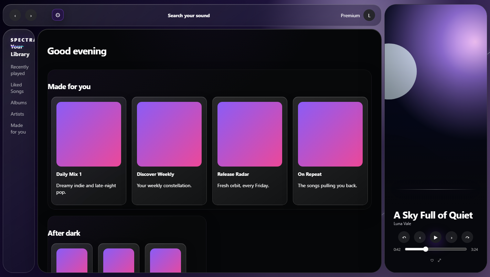
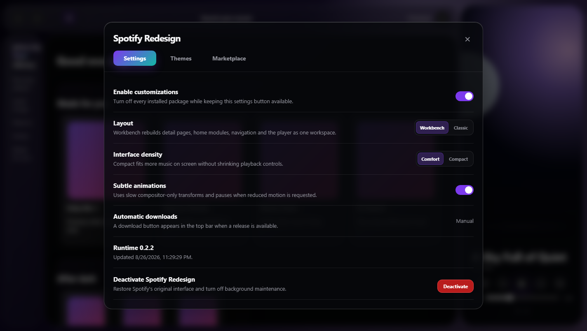
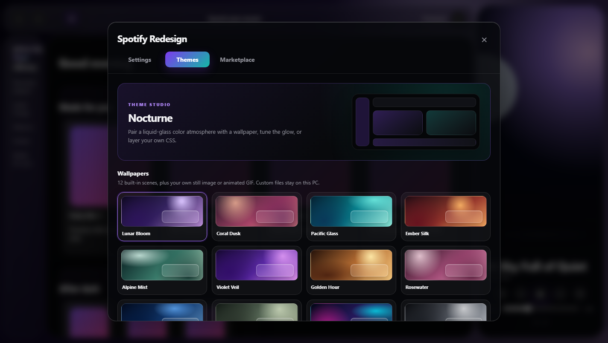
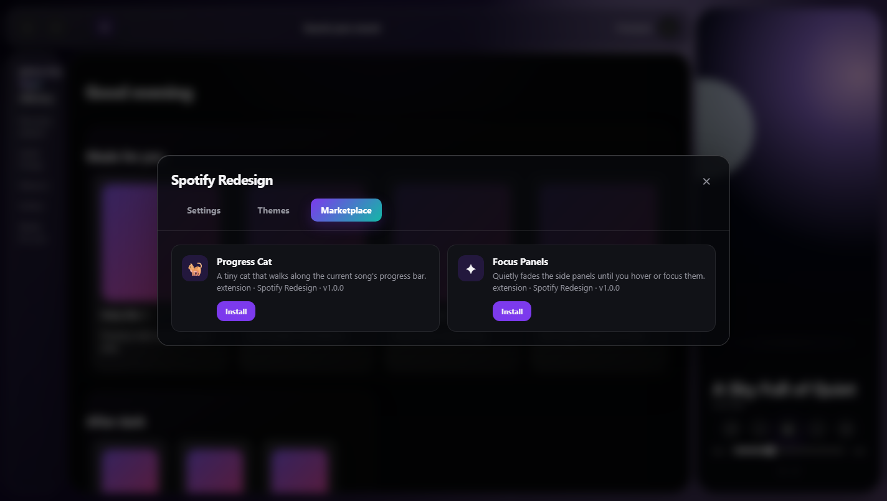

# Spotify Redesign — Project Review and AI Website Brief

Reviewed: 26 August 2026  
Project version: 0.2.2

## Executive summary

Spotify Redesign is an unofficial Windows desktop customization system for Spotify. It is not a music service, a separate Spotify client, or a Spicetify wrapper. It combines a Go-based installer and launcher with a browser-based UI runtime that is injected into Spotify Desktop's private `xpui` interface.

The product gives Spotify a more spacious, atmospheric “workbench” layout and adds a settings panel, theme studio, wallpaper picker, custom CSS support, extension marketplace, update controls, and a safe path back to the original Spotify interface.

The strongest website positioning is:

> A reversible, themeable desktop redesign that makes Spotify feel personal without replacing Spotify itself.

The project is currently best presented as a polished enthusiast/developer tool for Windows users who are comfortable installing an unofficial desktop customization.

## What the product can do

### Redesign Spotify Desktop

- Reorganizes Spotify into a spacious workbench-style interface with distinct navigation, content, now-playing, and player areas.
- Offers a **Workbench** layout and a more conservative **Classic** layout.
- Provides **Comfort** and **Compact** interface densities.
- Adds restrained, compositor-friendly motion that can be disabled and respects reduced-motion preferences.
- Keeps a settings button available in Spotify's top bar.

### Personalize the visual style

- Includes 10 switchable CSS themes: Nocturne, Carbon, Aurora, Crimson, Glacier, Ultraviolet, Ember, Moss, Monochrome, and Synthwave.
- Includes 12 built-in wallpaper scenes plus support for a local still image or animated GIF.
- Allows live adjustment of primary and secondary colors.
- Supports None, Ambient, and Grid background effects.
- Includes a local Custom CSS editor and `.css` file importer.
- Keeps custom wallpaper and CSS data on the user's PC.

### Install optional extensions

The bundled package marketplace currently contains two extensions:

- **Progress Cat** — places a small cat on the playback progress bar and updates it four times per second only while Spotify is visible.
- **Focus Panels** — fades side panels until they are hovered or focused.

Only packages declared by the signed/published update channel can be installed. The UI does not execute arbitrary URLs entered by a user.

### Install, launch, maintain, and restore

The standalone Go CLI supports installation, launching, applying the patch, status checks, configuration, updates, restoration, deactivation, and uninstallation.

- Direct Spotify installations use an unpacked, managed `Apps/xpui` directory.
- Microsoft Store installations leave the signed `WindowsApps` package untouched and use a writable app directory under `%LOCALAPPDATA%\SpotifyRedesign\AppX`.
- A per-user maintenance watcher can rebuild the customization after Spotify changes and can check for published updates while Spotify is closed.
- Users can restore Spotify's original UI, deactivate maintenance, or fully uninstall the customization.

### Update safely

- Browser assets are published through a versioned `channel.json` on GitHub Pages.
- Browser resources use Subresource Integrity hashes.
- CLI downloads are verified with SHA-256 before activation.
- Updates may download automatically or wait for a manual download action.
- Installation is always confirmed by the user; Spotify is only closed and restarted after the user selects **Update** and confirms.
- If the remote channel is unavailable, the last complete runtime embedded by the CLI remains available as a local fallback.

### Protect the original installation

- Creates SHA-256-addressed backups outside the Spotify installation.
- Uses ownership markers so it does not delete an `xpui` directory managed by another tool.
- Provides explicit restore, deactivate, and uninstall paths.
- Does not replace `Spotify.exe` and does not modify the signed Microsoft Store package.

## Product architecture

| Layer | Technology | Responsibility |
|---|---|---|
| Windows CLI | Go 1.23 | Detect Spotify, back up and patch assets, launch, restore, configure, maintain, and update |
| Injected runtime | TypeScript and browser DOM APIs | Add the layout engine, settings modal, update UI, theme system, and package lifecycle |
| Visual system | CSS | Layouts, density, glass styling, themes, wallpaper effects, and responsive behavior |
| Extension runtime | TypeScript packages | Register independently activated UI enhancements |
| Distribution | GitHub Actions, Releases, and Pages | Build the Windows executable and publish the verified browser update channel |
| Local state | `%LOCALAPPDATA%\SpotifyRedesign` and browser storage | Configuration, backups, CLI versions, update state, installed packages, CSS, and wallpapers |

The project intentionally uses a small dependency footprint: the browser runtime is based on DOM APIs and CSS, while the build uses TypeScript and esbuild.

## Screenshots

These screenshots were captured from a fresh version 0.2.2 build using the repository's Spotify UI harness. No installed Spotify application or personal account data was modified.

### Main workbench redesign



### Settings and layout controls



### Theme studio and wallpaper picker



### Extension marketplace



## Recommended website structure

### 1. Hero

Eyebrow:

> Unofficial Spotify Desktop customization for Windows

Headline:

> Make Spotify feel like your space.

Supporting copy:

> Rebuild Spotify Desktop with atmospheric themes, flexible layouts, local wallpapers, and optional extensions — with verified backups and a clear way back to the original interface.

Primary CTA: **Install Spotify Redesign**  
Secondary CTA: **Explore the themes**

Place the main workbench screenshot beside or beneath the copy. Include the unofficial-project disclaimer directly in the hero or immediately below it.

### 2. Product proof

Use four concise proof points:

- 10 visual themes
- 12 built-in wallpapers
- 2 optional extensions
- Reversible installation

Avoid presenting the theme and extension counts as permanent promises; both are registry-driven and can grow.

### 3. Feature story

Use the settings screenshot with short callouts for layout, density, motion, update preference, and deactivation. The central message should be that this is a controlled desktop customization, not merely a collection of CSS files.

### 4. Theme studio

Use the theme screenshot and explain themes, wallpapers, live palette controls, background effects, and Custom CSS. Emphasize that custom files remain local.

### 5. Extensions

Use the marketplace screenshot and introduce Progress Cat and Focus Panels. Explain that extensions have activation/deactivation lifecycles and are limited to the published registry.

### 6. How it works

Present a simple three-step flow:

1. **Back up** — the CLI verifies and stores Spotify's original interface archive.
2. **Redesign** — two marked scripts load the local/verified customization runtime.
3. **Restore anytime** — deactivate or uninstall to return to Spotify's original interface.

Add a separate note for Microsoft Store users explaining that the signed package remains untouched.

### 7. Safety and updates

Explain verified backups, ownership markers, integrity-checked assets, manual update confirmation, and offline fallback. This section is important because patching a desktop application naturally raises trust questions.

### 8. Installation and requirements

List:

- Windows
- Spotify Desktop, direct or Microsoft Store edition
- Spotify must be completely closed during install, restore, or uninstall
- PowerShell installer or the built CLI

Link to the repository installation instructions. Keep advanced channel and CLI configuration in documentation rather than the landing page.

### 9. FAQ and disclaimer

Recommended questions:

- Is this affiliated with Spotify?
- Does it use Spicetify?
- Can I restore the original interface?
- Does it support the Microsoft Store edition?
- Where are custom wallpapers and CSS stored?
- What happens after Spotify updates?
- Are updates installed automatically?

Required disclaimer:

> Spotify Redesign is an unofficial personal customization project and is not affiliated with, endorsed by, or sponsored by Spotify. Spotify updates can change the private desktop interface at any time.

## Visual direction for the website

- Use an ink-black background with violet and teal lighting derived from the Nocturne theme.
- Build large rounded glass panels with fine borders, low-opacity gradients, and restrained blur.
- Keep typography bold and compact for headings, neutral and highly readable for body copy.
- Use the real screenshots as the primary visual proof; avoid generic music-app mockups.
- Use motion sparingly: slow ambient gradients, small hover lifts, and crossfades are enough.
- Keep the wordmark text-based unless a dedicated original logo is created. Do not imitate Spotify's trademarked icon.
- Make the page responsive, but describe the product itself as Windows desktop software rather than a mobile application.

## Ready-to-paste AI website prompt

```text
Create a polished responsive landing page for “Spotify Redesign,” an unofficial Windows desktop customization for Spotify. This is not a streaming service, a separate Spotify client, or a Spicetify wrapper. It is a reversible Go-based patcher and launcher with an injected TypeScript/CSS runtime.

Visual style: premium dark desktop software, ink-black background, Nocturne-inspired violet and teal ambient light, large rounded glass panels, thin borders, crisp white typography, muted gray body text, and restrained motion. Do not copy Spotify's logo or imply official affiliation.

Use these real product screenshots:
- docs/screenshots/01-main-redesign.png
- docs/screenshots/02-settings-panel.png
- docs/screenshots/03-theme-studio.png
- docs/screenshots/04-package-marketplace.png

Page order:
1. Hero with “Make Spotify feel like your space,” supporting copy, Install and Explore themes CTAs, and the main workbench screenshot.
2. Proof strip: 10 themes, 12 wallpapers, 2 optional extensions, reversible installation.
3. Settings feature section covering Workbench/Classic layouts, Comfort/Compact density, motion, update preference, and deactivation.
4. Theme Studio section covering 10 themes, built-in and custom wallpapers/GIFs, live two-color palette controls, background effects, and local Custom CSS.
5. Extension marketplace section for Progress Cat and Focus Panels.
6. Three-step “Back up, Redesign, Restore anytime” explanation.
7. Safety section for SHA-256 backups, ownership markers, integrity-checked resources, local fallback, and user-confirmed updates.
8. Requirements and installation section for Windows and Spotify Desktop, including direct and Microsoft Store editions.
9. FAQ and a clear unofficial-project disclaimer.

Use accessible semantic HTML, visible keyboard focus, good contrast, reduced-motion support, optimized screenshots, and clean responsive behavior. Keep claims technically precise. Do not claim Mac, Linux, mobile, browser-player, weather-aware, genre-aware, BPM-reactive, or automatic mood-video features.
```

## Review findings and product risks

### Strengths

- Clear product identity beyond a skin: patcher, launcher, settings UI, extension runtime, updater, and recovery system are integrated.
- Thoughtful safety model with verified backups, ownership markers, local fallback, and deliberate update installation.
- Strong visual differentiation and a polished in-product settings experience.
- Direct and Microsoft Store Spotify installations are both considered.
- Small, understandable browser runtime and extension lifecycle.
- Automated release pipeline builds, checks, publishes, and hashes deliverables.

### Constraints to state honestly

- Windows only.
- Depends on Spotify's private desktop UI format, which can change after Spotify updates.
- Requires modifying or rebuilding Spotify's web UI assets and therefore carries more installation friction than a normal app.
- The marketplace currently contains two packages.
- The product harness demonstrates the redesign, but final compatibility must still be tested against current real Spotify Desktop builds.
- The experimental design documents describe future concepts such as weather-aware, genre-aware, video, canvas, and BPM-reactive backgrounds. Those are not current product capabilities and should only appear as roadmap ideas.

### Documentation cleanup recommended before launch

- The README says “four” deployable CSS themes, while the current registry contains 10. Update the README count or make the wording count-independent.
- Add a short privacy statement covering local CSS/wallpaper storage and the update channel's network requests.
- Add a compatibility matrix listing verified Spotify Desktop versions and installation modes.
- Add a short troubleshooting section for Spotify updates, restoration, and Store-mode launch redirection.

## Verification

- `npm run build` — passed
- `npm run check` — passed, including TypeScript validation and all Go tests
- Fresh browser runtime — version 0.2.2
- Screenshots — visually inspected at a 1440 × 900 capture target

